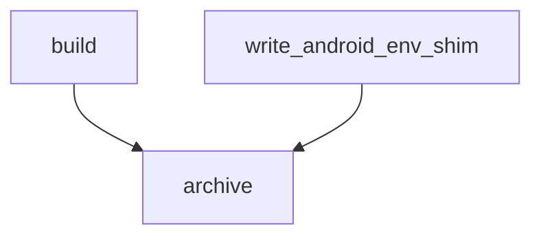
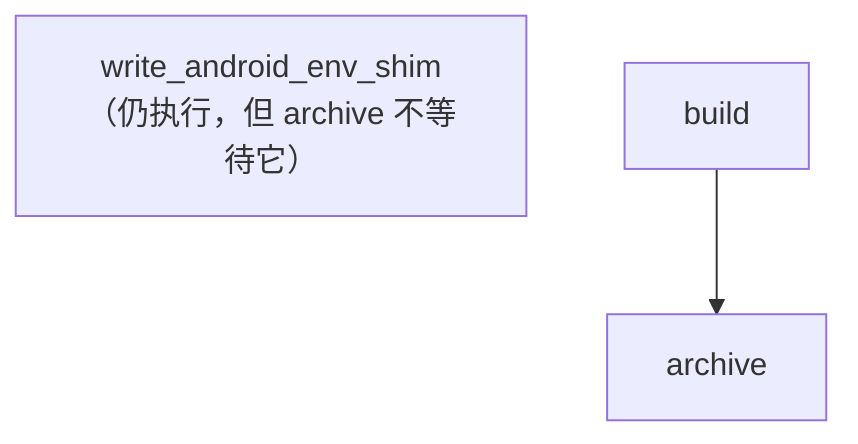
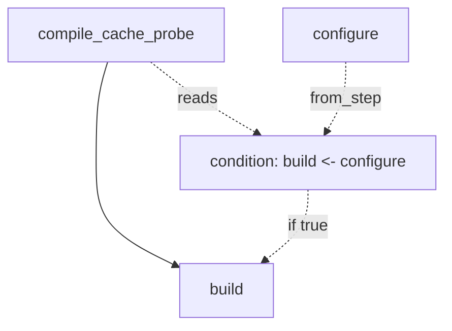
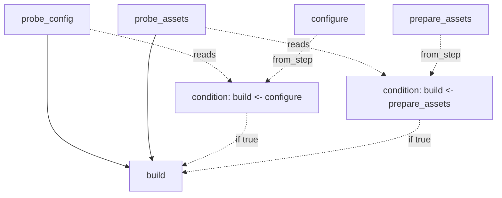

# 条件边

[English](../conditional_edges.md) | 简体中文

## 当前状态

当前 graph core 已经具备条件边基础设施：

- 高层统一使用 `ConditionalEdge`
- 条件分成：
  - `StaticCondition`
  - `RuntimeCondition`
- Rust compiler 支持静态条件裁剪与运行时条件 lowering
- Rust execution session 支持运行期条件批量求值

本文只说明 Graph 的公开语义，不假设某个宿主业务是否采用条件边。

## 目标

条件边解决的是：

- 图结构上确实存在一条“可选依赖”
- 但这条依赖是否生效，不一定总是固定的

也就是说，它表达的是：

- “当前 step 依赖某个前置 step”
- 但这条依赖的成立，本身有条件

当前 graph 模型里统一使用：

- `ConditionalEdge(source, target, condition)`

作者语法通常使用：

- `target.wire(after=(ConditionalPrerequisite(source, condition=...),))`

`Graph.from_wiring(...)` 会把它一次解析成规范化 `ConditionalEdge`。

而不是：

- 给 step 增加另一套隐式 hook
- 或在 runtime 里偷偷改调度逻辑

若要表达：

- 某个 step / 子图本身是否执行

应使用：

- [conditional_steps.md](./conditional_steps.md)

## 为什么不继续只用 `skip_step(...)`

宿主也可以通过下面这些机制表达条件行为：

- probe step
- `skip_step(...)`
- `skip_steps(...)`

来实现的。

这条路能工作，但它的问题是：

- 条件藏在 step 行为里
- 图结构本身看不出“这条依赖其实是可选的”
- 一旦需要做 compiled 图、渲染图、检查图，就不够显式

条件边的目标不是取代所有 `skip_step(...)`，而是把**真正属于图结构的可选依赖**显式建模出来。

## 两类条件边

当前统一模型里，条件分两类：

- `StaticCondition`
- `RuntimeCondition`

两者共用同一个高层边模型：

- `ConditionalEdge`

区别只在于：

- 条件在什么时候求值
- 条件读取什么输入

实际处理顺序是：

- 声明编译时通过显式 evaluator 求值静态条件，裁剪无效关系
- 将运行时条件 lower 为带 ConditionId 的 prerequisite
- 进入统一 Rust execution session

当前没有独立的公开 `freeze` API；静态裁剪在声明编译调用中完成。

compiled graph 不再保留声明态 `ConditionalEdge`，而是把它归一化成
`CompiledConditionalDependency`。条件 predicate 仍在运行期求值，但不会
生成额外的 gate step。

如果运行时条件边位于子图内部，子图叶子仍会扁平化。原子图边界由
`CompiledComposite` 维护，父级后继必须等待 composite 的全部直接子节点终态，
不会因为某条条件边为假而提前越过整个子图。

## 静态条件边

静态条件边表示：

- 这条依赖能不能成立
- 在声明编译前就已经知道

例如：

- 当前 target 是否是 Android
- 当前 linkage 是否是 shared
- 当前 feature 是否开启

这类条件不会读取运行时 step result。

### 当前静态条件模型

位置：[static_condition.py](../../src/rivetoo_graph/static_condition.py)

graph core 现在只要求静态条件是显式数据：

- `payload`
- `description`

例如：

```python
StaticCondition(
    payload=SomePayload(...),
    description="environment(production)",
)
```

graph core 不再内建：

- `environment(...)`
- `deployment_tier(...)`
- `artifact_kind(...)`

这类宿主领域表达式。

### 静态条件怎么求值

graph core 也不解释 `payload` 的业务语义。  
编译阶段统一委托给：

- `static_condition_eval`

来判断真假。

这份求值入口现在挂在：

- `Graph.static_condition_eval`

这意味着：

- graph core 只负责：
  - 遍历图
  - 发现静态条件边
  - 调静态条件求值入口
  - 真则保留边
  - 假则删除边
- 具体“这份 payload 代表什么业务条件”，由上层 evaluator 解释

这也是当前静态条件设计最关键的边界：

- graph core 负责：
  - 遍历图
  - 管声明编译过程
  - 生成新的编译结构，不修改原始声明图
- 上层业务负责：
  - 定义静态条件 payload
  - 定义静态条件求值逻辑

当前 `static_condition_eval` 同时支持两种形态：

- `StaticConditionEvaluator`
- `Callable[[StaticCondition], bool]`

也就是说：

- 如果上层需要显式对象和复用状态，可以传 evaluator 对象
- 如果只是局部、轻量的静态条件求值，也可以直接传函数

具体宿主可以在 Graph core 之外定义自己的静态条件 payload 和 evaluator。Graph
只保存不透明 payload，并在声明编译时调用显式传入的求值入口。

而这几种组合能力现在属于 graph 自身的静态条件基础能力：

- `all_(...)`
- `any_(...)`
- `not_(...)`

也就是：

- 业务条件由宿主显式提供
- 组合条件由 graph core 自己提供

要注意：

- `all_ / any_ / not_` 只是静态条件组合器
- 它们不负责解释业务条件 payload
- 只要组合里最终包含需要业务解释的叶子静态条件，仍然必须提供：
  - `Graph.static_condition_eval`

也就是说，下面这种写法本身并不会让静态条件“自动可用”：

```python
condition = all_(
    StaticCondition(payload="android", description="target OS is Android"),
    StaticCondition(payload="shared", description="shared linkage"),
)
```

上例字符串是宿主自己约定的 payload，Graph 不解释它们。
如果图上用了这类静态条件，而 `Graph.static_condition_eval` 为空，声明编译会直接报错。

### 静态条件边的例子

假设：

- `archive` 只有在 Android 上才需要等待 `write_android_env_shim`
- 此例故意只控制依赖边；来源 Step 本身始终启用

高层图可以写成：

```python
build = Step(build_archive_input, label="build")
write_android_env_shim = Step(write_shim, label="write_android_env_shim")
archive = Step(create_archive, label="archive")

graph = Graph.from_wiring(
    wiring=(
        build.wire(),
        write_android_env_shim.wire(),
        archive.wire(
            after=(
                build,
                ConditionalPrerequisite(
                    write_android_env_shim,
                    condition=StaticCondition(
                        payload=AndroidOnlyPayload(),
                        description="target_os(android)",
                    ),
                ),
            )
        ),
    ),
    static_condition_eval=evaluate_target_condition,
)
```

如果 evaluator 判定当前 target 是 Android，编译后就变成普通边：



如果当前 target 不是 Android，编译后就是：



注意：

- 静态条件边不会进入 compiled graph
- 条件为真则变成普通依赖，为假则移除这条边
- 边为假不删除来源 Step；要让来源 Step 也不运行，应给它声明 `Step.when`
- 上例中的 payload、evaluator 和领域辅助函数由宿主提供，不是 Graph 的内置平台 API

## 运行期条件边

运行期条件边表示：

- 这条依赖能不能成立
- 只有在运行时才知道

例如：

- cache probe 的结果
- 某个前置 step 实际输出
- 某个运行期检测结果

这类条件需要读取 step result，因此不能在声明编译阶段直接消掉。

### 当前运行期条件模型

位置：

- [src/rivetoo_graph/model.py](../../src/rivetoo_graph/model.py)

当前模型是：

```python
class RuntimeCondition:
    when: ConditionalEdgePredicate
    reads: tuple[Step, ...] = ()
```

其中：

- `when`
  - 运行期判定函数
  - 基于 `StepReadContext`
- `reads`
  - 这条条件在求值前，还要先读取哪些 step 的结果

一条运行时条件边的编译实例在当前 session 中最多判定一次。若条件为真但它指向的
原始前置 step 尚未完成，后续调度刷新只等待该前置 step，不会再次调用
predicate。该缓存属于编译后的条件实例；把同一个 `RuntimeCondition` 或 predicate
用于多个位置，不代表跨位置只求值一次。

### `reads` 为什么不是普通 `after`

这里最容易混淆。

- `after`
  - 表达的是 step 本身总要先等谁
- `reads`
  - 表达的是这条条件在判断真假时，还要先看谁的结果

也就是说：

- `after` 是 **step 级执行依赖**
- `reads` 是 **条件边级求值依赖**

它们不是同一层语义。

换句话说：

- `after`
  - 回答的是：这个 step 本身总要先完成谁
- `reads`
  - 回答的是：为了判断这条条件边真假，还要先读取谁的结果

### 一个单条件边例子

假设：

- `build` 总是要等 `compile_cache_probe`
- `build` 只有在 cache miss 时才依赖 `configure`
- 而 cache miss 的判断，要读取 `compile_cache_probe` 的结果

高层写法会是：

```python
compile_cache_probe = Step(probe_cache, label="compile_cache_probe")
configure = Step(configure_source, label="configure")
build = Step(build_source, label="build")

graph = Graph.from_wiring(
    wiring=(
        compile_cache_probe.wire(),
        configure.wire(),
        build.wire(
            after=(
                compile_cache_probe,
                ConditionalPrerequisite(
                    configure,
                    condition=runtime_condition(
                        when=cache_miss,
                        reads=(compile_cache_probe,),
                    ),
                ),
            )
        ),
    )
)
```

这条边的真实语义可以画成：



重点是：

- `compile_cache_probe -> build`
  - 是 step 级无条件依赖
- `reads=(compile_cache_probe,)`
  - 是条件求值依赖
- `configure`
  - 是这条条件边指向的原始前置 step

### 多条运行期条件边挂在同一个 step 上

如果一个 step 同时有两条条件边，`reads` 的作用会更清楚。

假设：

- `build` 只有在 `config_miss` 时才依赖 `configure`
- `build` 只有在 `assets_missing` 时才依赖 `prepare_assets`
- 第一条条件读 `probe_config`
- 第二条条件读 `probe_assets`

高层语义就是：

```text
build.wire(after=(
  probe_config,
  probe_assets,
  ConditionalPrerequisite(
    configure,
    condition=runtime_condition(
      when=config_miss,
      reads=(probe_config,),
    ),
  ),
  ConditionalPrerequisite(
    prepare_assets,
    condition=runtime_condition(
      when=assets_missing,
      reads=(probe_assets,),
    ),
  ),
))
```

图上可以理解成：



这里如果没有 `reads`，你就无法表达：

- 第一条条件边读谁
- 第二条条件边又读谁

这也是为什么 `reads` 不能直接并入 step 的 `after`：

- `after` 挂在 step 上
- `reads` 挂在某一条具体条件边上

一个 step 可以同时有多条条件边，而每条边读取的结果可能都不同。

## 执行时如何处理条件边

正式执行由 Rust 声明编译器先消掉全部 `StaticCondition`，再把
`RuntimeCondition` 编译为带 condition id 的 prerequisite。Rust execution session
只会看到：

- 普通边
- ConditionId、reads 和已编译的条件依赖；Python predicate 保存在 adapter 侧表

它不会再看到：

- `StaticCondition`

静态条件在声明编译阶段完成，不进入 runtime 求值协议。

因此，runtime 的正式边界是：

- 它只处理：
  - 普通边
  - 编译后的运行时条件引用
- 它不处理：
  - `StaticCondition`

## Compiled 路径如何处理条件边

`compile_graph(...)` 在同一次原生调用中完成静态裁剪、运行时条件边归一化、子图
结构编译和组合生命周期建模。

也就是说：

- 静态条件边在编译后消失
- 运行期条件边作为 compiled prerequisite 保留
- 不新增 action、step 或 worker 任务
- 子图内部使用相同模型，不切换回另一套动态图执行

## Compiler 归一化后长什么样

还是上面这个例子：

- `build` 总是等 `compile_cache_probe`
- `build` 只有在 cache miss 时才依赖 `configure`

编译结果直接保留在 `CompiledStep.after`：

```python
CompiledStep(
    ref=CompiledStepRef(...),
    after=(
        CompiledStepRef(StepId((0,))),
        CompiledConditionalDependency(
            node=CompiledStepRef(StepId((1,))),
            condition=CompiledRuntimeCondition(
                reads=(CompiledStepRef(StepId((0,))),),
                when=...,
            ),
        ),
    ),
    ...,
)
```

调度器先等待 `reads`，再求值条件。条件为假时忽略 `configure` 依赖；
条件为真时等待 `configure` 完成。条件来源直接存在于依赖对象中，不需要
metadata 解释一个编译器伪造的 step。

## 设计边界

当前这套条件边基础设施已经具备：

- 高层统一 `ConditionalEdge`
- `StaticCondition`
- `RuntimeCondition`
- 声明编译与静态裁剪
- compiled lowering

Graph core 只定义条件结构、求值时机和调度语义。宿主负责决定哪些领域关系适合
建模成条件边，不能把隐藏副作用或领域回退策略塞进 predicate。
